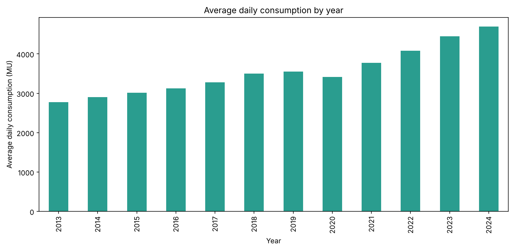
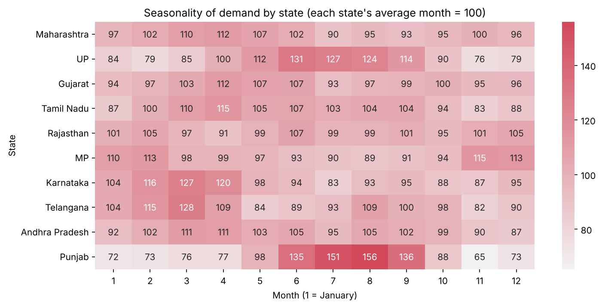
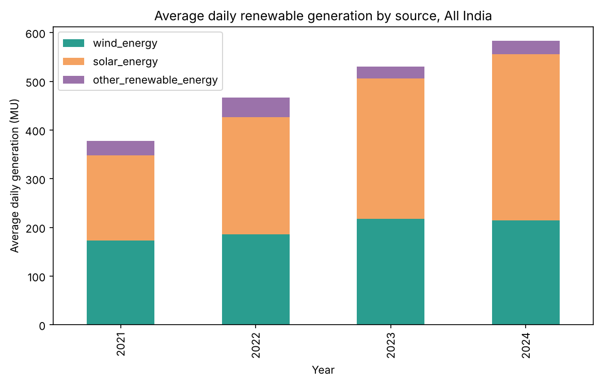
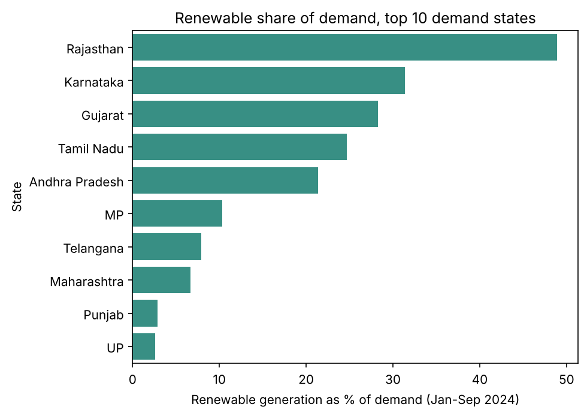

# India's Electricity Demand and Renewable Generation
### Where is the headroom for renewable energy?

A Python analysis of daily electricity demand by state (January 2013 to September 2024) and daily renewable generation by state (October 2019 to April 2025). The analysis is written as if advising a renewable energy company that has to decide where and when to add capacity.

Built with **pandas, numpy, matplotlib and seaborn** for a PGDM project at IILM, New Delhi.

## Key findings

- **Demand is growing, and growth has picked up.** Average daily consumption rose from about 2,771 million units (MU) in 2013 to about 4,693 MU in 2024, roughly +69%. It grew 8 to 10.5% a year from 2021 to 2023 and fell 3.8% in 2020 (COVID-19 lockdown).
- **Seasonality differs by state.** Punjab swings the most (highest month about 2.4 times its lowest), then Uttar Pradesh. The southern states, Gujarat and Maharashtra peak in March to April, and Madhya Pradesh peaks in winter.
- **Renewables are growing faster than demand, led by solar.** From 2021 to 2024 renewable generation grew about 54% (roughly 378 to 583 MU a day) against about 24% for demand. Solar rose about 95% and wind about 24%.
- **Renewables still cover a small share.** They met 12.4% of demand in 2024 (10.0% in 2021) and supplied about 22% of the growth in demand.
- **Supply is concentrated.** Rajasthan, Gujarat, Tamil Nadu and Karnataka produce about 72% of India's renewable generation. Among the ten largest-demand states, renewables cover 48.9% of demand in Rajasthan but only 6.7% in Maharashtra, 2.9% in Punjab and 2.6% in Uttar Pradesh (January to September 2024).

## Charts

## Data

| Dataset | Content | Source |
|---|---|---|
| `Indias_Electricity_Consumption_Dataset.csv` | Daily consumption (MU) by state, 6 Jan 2013 to 29 Sep 2024 | [Kaggle: India's Electricity Consumption Dataset](https://www.kaggle.com/datasets/aryankhurana1701/state-wise-electricity-consumption-in-india), compiled from POSOCO / Grid-India reports |
| `Renewable.csv` | Daily wind, solar, other and total renewable generation by state, 30 Oct 2019 to 27 Apr 2025 | [India Data Portal: Daily Renewable Energy Generation](https://ckandev.indiadataportal.com/dataset/power/resource/f009766a-c8b1-4322-91dd-f13dd653b45b), based on Central Electricity Authority data |

The data belongs to its original sources. Check their terms before reusing it.

## How to run

1. Download or clone this repository.
2. Install the libraries: `pip install -r requirements.txt`
3. Keep `Analysis_clean.ipynb` and both CSV files in the same folder.
4. Open the notebook in Jupyter or VS Code and run all cells from the top. The charts are saved to the `images/` folder.

## What is in the notebook

- **Part 1: Demand data.** Cleaning, missing-data checks, yearly and monthly trends, box plot, top states, seasonality heatmap and a simple trend baseline.
- **Part 2: Renewable data.** Cleaning, missing-data checks, growth, the source mix (bar and pie), state ranking, timing against demand and renewable share of demand by state.
- **Part 3: Conclusions.** Findings, limitations and possible extensions.

## Limitations

- Both files have gaps: 578 of 4,285 days are missing in the demand file (including January to March 2023) and 83 of 2,007 in the renewable file (mostly February to March 2020). None were filled.
- The two datasets come from different sources. The unit of the renewable file is not stated, so shares of demand are indicators and not official figures.
- Consumption is not unmet demand, and states trade power, so generation inside a state is not the same as the power used there.
- The data holds daily totals only, with no weather, land, grid or policy information.

## Author

Kiran Bhowmik, PGDM 2025-27, IILM Lodhi Road, New Delhi.
